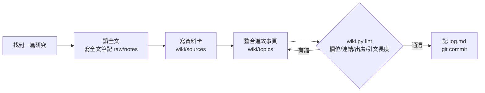
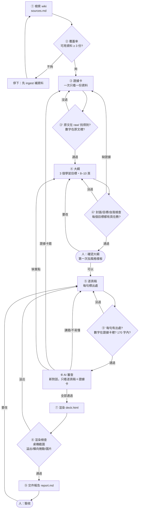

# 流程圖：從資料到教學簡報

這個專案有兩條流程：**ingest**（把一篇研究加進 wiki）和 **story-slides**（用 wiki 為一個故事做簡報）。兩條都是「圖」而不是一條直線：每做完一步就有一道檢查，沒過就退回出錯的那一步重做。

## 一、ingest：一次一篇

- **重複的步驟**：每篇資料都跑一次同樣的流程；一次只處理一篇，避免把不同研究的說法混在一起。
- **檢查點**：`lint` 確認每個段落都有出處、連結都點得到、引文不超過 50 字。

## 二、story-slides：一個故事一份簡報

## 為什麼這樣設計

| 設計 | 理由 |
|---|---|
| 每一關都是一支腳本（`tools/slides.py` 的子指令），結束碼 0 才往下 | 「做完了」由腳本判斷，不是 AI 自己說做完了 |
| 錯誤在離源頭最近的地方擋 | 數字抄錯如果到 ⑥ 審查才發現，要從證據卡一路重做；在 ③' 就擋下來只要改一條 |
| 證據卡一次只看一份資料 | 避免把 A 研究的數字說成 B 研究的 |
| AI 審查開新對話，只給逐頁稿和證據卡 | 寫的人看不出自己的錯；審查者沒看過故事頁，只能拿證據卡比對 |
| 人只在三個地方介入：風格樣板、大綱、驗收 | 方向錯了最貴，所以大綱先給人看；細節交給腳本檢查 |
| 剎車：同一關連續 3 輪沒過就停 | 避免 AI 在同一個錯誤上無限繞圈 |
| 每一關的產出都是檔案（`slides/<id>/`） | 能打開看、放進 git、單獨重跑某一關 |

## 每一關檢查什麼

| 關卡 | 指令 | 擋下什麼 |
|---|---|---|
| ② 覆蓋率 | `slides.py retrieve` | 讀到全文的資料少於 3 份 |
| ③' 證據卡 | `slides.py cards` | 原文在 raw/ 找不到（抄錯、自己改寫）；事實裡的數字原文沒有；原文超過 50 字 |
| ④' 大綱 | `slides.py outline` | 頁數不在 8–10；缺封面／目標／自我檢查；有學習目標沒頁在教；引用不存在的證據 |
| ⑤' 逐頁稿 | `slides.py script` | 句子沒出處；數字在引用的證據卡裡找不到；超過 170 字；compare 兩邊用同一份資料 |
| ⑥ AI 審查 | `slides.py review` | 講錯、誇大、不易懂、缺重點 |
| ⑧ 渲染 | `slides.py render` | 桌機溢出、橫向捲動、圖片壞掉、主控台錯誤 |

實際跑過的紀錄見各簡報的 `slides/<id>/report.md`。
