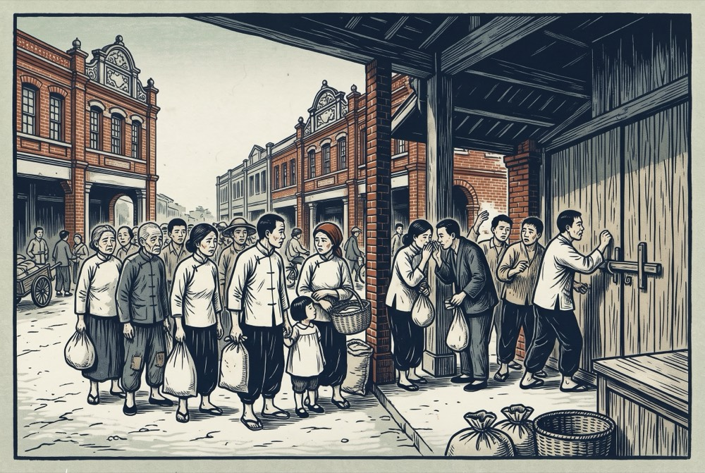
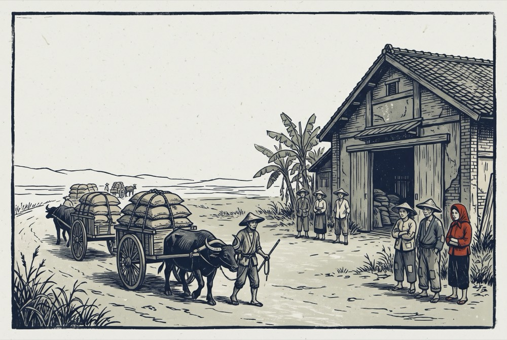

## 一句話說明

1945 年 8 月戰爭結束，大家以為苦日子過去了；沒想到臺北一斤米從 1.9 元一路漲到 1947 年 4 月的 71 元，「米荒」成了二二八事件前民怨的一部分。

## 故事是這樣的

戰爭最後一年，臺灣的米已經大減產。1945 年全島只收成約 447 萬石糙米，不到 1938 年高峰（約 982 萬石）的一半（[李力庸 2009](../sources/s-2009-li-grain-regulation.md) 頁 77）。原因是肥料斷了、壯丁被徵召、1945 年 9 月颱風重創臺南高雄、兩百多處水利設施被炸壞（[蘇瑤崇 2014](../sources/s-2014-su-postwar-rice.md) 頁 101）。

吃得也少了。根據戰後美方的估算，1945 年臺灣每人每天能吃到的食物只剩 620 公克，是戰前（1935–39 平均）的六成；魚從每天 56 公克掉到 6 公克，肉從 51 公克掉到 16 公克（[曾品滄 2018](../sources/s-2018-tseng-public-diet.md) 頁 125）。

接收初期，新政府其實延續了日本時代的管制：1945 年 10 月 31 日頒布「管理糧食臨時辦法」，繼續收購和配給（[蘇瑤崇 2014](../sources/s-2014-su-postwar-rice.md) 頁 103）。可是跟日本時代不同，這次**只配給公教人員**，一般人得自己去零售店買；負責收米、配米的農業會和食糧營團，也要到 1946 年 3 月才被接收（[曾獻緯 2015](../sources/s-2015-tseng-postwar-food-control.md) 頁 61–62）。農民交了米卻領不到配給，缺糧時還得去黑市買，當時的說法是「賣的是公價，買的是黑市價」（[曾獻緯 2015](../sources/s-2015-tseng-postwar-food-control.md) 頁 64）。但當年 12 月，官定米價每臺斤 1 元，黑市已經喊到 5 元 5 角到 6 元（[蘇瑤崇 2014](../sources/s-2014-su-postwar-rice.md) 頁 109）。政府的收購價也遠低於市價：1946 年征購價每百斤 106.23 元，而 1945 年 12 月市場上每百斤要 253.84 元（[蘇瑤崇 2014](../sources/s-2014-su-postwar-rice.md) 頁 117）。

1946 年 1 月 11 日，政府突然宣布廢除米穀管制，隔天起停止配給、米可以自由買賣（[蘇瑤崇 2014](../sources/s-2014-su-postwar-rice.md) 頁 119）。在這之前，臺灣廣播電台做過一次糧食民意測驗，結果反對配給 32,656 票、贊成 24,404 票（[蘇瑤崇 2014](../sources/s-2014-su-postwar-rice.md) 頁 118）。但同一時間，政府在各地**封存**倉庫裡的存米。糧食局自己報的數字是 15,324 噸，蘇瑤崇從另一份電文推算，實際可能超過 11 萬噸（[蘇瑤崇 2014](../sources/s-2014-su-postwar-rice.md) 頁 122–123）。市場上的米一下子變少，價格應聲上漲：臺北每公斤米 1 月 11.12 元、2 月 21.57 元、3 月 29.67 元（[曾獻緯 2015](../sources/s-2015-tseng-postwar-food-control.md) 頁 70）。霧峰鄉民數百人到公所抗議，竹東有數百人攻進農業會倉庫拿走 10 萬斤米（[曾獻緯 2015](../sources/s-2015-tseng-postwar-food-control.md) 頁 70）。

米荒時，地方上也有人自己想辦法。1946 年 2 月，鹿港的義勇警察隊和各部落會長一起調查貧困的人家，分配平價米（[陸文楓 2025](../sources/s-2025-lu-police-society.md) 頁 87）。在這之前幾個月，日本時代管配給的經濟警察已經成了眾矢之的：1945 年 9 月 10 日臺南有人毆打經濟警察，後來還擴大成攻擊替日本官方做事的臺灣人（同上，頁 58）。

封存的米去了哪裡？霧峰的林獻堂在日記裡記下，1946 年 3 月有人要從臺中縣調走 4,000 噸米；3 月 14 日，霧峰農業會的 2,000 多包存米被搬得一空（[蘇瑤崇 2014](../sources/s-2014-su-postwar-rice.md) 頁 123–124）。

至於「米被運去中國」的說法，蘇瑤崇查了檔案：救濟總署確實曾想把臺灣米運出去，但長官公署農林處回覆「實無餘糧可資出口」，軍方要買 15 萬大包也被擋下；反倒是福建答應送來 20 萬石米，最後只到了 4,844 石（[蘇瑤崇 2014](../sources/s-2014-su-postwar-rice.md) 頁 106–111、126）。

米價在 1947 年初失控。官方月報記錄的臺北蓬萊米，1946 年 12 月每斤 23.98 元，1947 年 2 月 42.22 元，4 月 71.11 元（[陳懷德、楊海亮 2025](../sources/s-2025-chen-rice-price-dataset.md)）。2 月 13 日《民報》報導市面米價已經喊到 32 元；同一天政府公布最高米價，臺北蓬萊米限 23 元。限價之後米店乾脆關門：2 月 14 日《民報》頭條說市面無米可賣，只聽說暗市有一斤 40 元的；2 月 25 日報導新竹米攤與米店全都關門，暗市喊到 40 元左右（[吳聰敏 2023](../sources/s-2023-wu-rice-shortage-excerpt.md) 段 39–42）。吳聰敏文中還寫 2 月米價比 1 月漲 93.9%，但沒有註明出處；用官方月報 1 月 25.57 元、2 月 42.22 元來算，約漲 65%（本站計算），兩者口徑可能不同（[吳聰敏 2023](../sources/s-2023-wu-rice-shortage-excerpt.md) 段 43；[陳懷德、楊海亮 2025](../sources/s-2025-chen-rice-price-dataset.md)）。兩週後，二二八事件爆發。

## 數字會說話

**終戰後的米價：一斤從 1.9 元漲到 71 元**（單位：舊臺幣元／斤（500 公克），臺北蓬萊米上等零售價）

| 項目 | 臺北米價 |
|---|---|
| 1945-08 | 1.9 |
| 1945-09 | 2.0 |
| 1945-10 | None |
| 1945-11 | None |
| 1945-12 | None |
| 1946-01 | 8.43 |
| 1946-02 | 16.78 |
| 1946-03 | 22.0 |
| 1946-04 | 21.42 |
| 1946-05 | 27.36 |
| 1946-06 | 19.7 |
| 1946-07 | 17.05 |
| 1946-08 | 20.14 |
| 1946-09 | 15.06 |
| 1946-10 | 18.9 |
| 1946-11 | 18.95 |
| 1946-12 | 23.98 |
| 1947-01 | 25.57 |
| 1947-02 | 42.22 |
| 1947-03 | 62.28 |
| 1947-04 | 71.11 |

逐月資料，出自官方《臺灣物價統計月報》，缺漏月份以報紙與研究補足；1945 年 10–12 月無資料。1946 年 1 月為作者加權修正值。數值四捨五入到小數兩位。 出處：[陳懷德、楊海亮 2025](../sources/s-2025-chen-rice-price-dataset.md)

**一個臺灣人一天能吃到多少？**（單位：公克／人／天）

| 項目 | 1935–39 平均 | 1940–44 平均 | 1945 |
|---|---|---|---|
| 米 | 251 | 298 | 237 |
| 番薯 | 309 | 250 | 184 |
| 蔬菜 | 170 | 122 | 103 |
| 肉 | 51 | 30 | 16 |
| 魚 | 56 | 27 | 6 |

Gleason（1956）估算的每人每日可供量，轉引自曾品滄（2018）表 1（頁 125），本站已對照原頁影像。這是全島平均的「可供量」，不是實際吃進去的量。1945 年食物總量 620 公克，是戰前 994 公克的 62%。 出處：[曾品滄 2018](../sources/s-2018-tseng-public-diet.md)

**1945 年 11 月：政府收購價 vs. 市場價**（單位：元／每百公斤糙米）

| 項目 | 價格 |
|---|---|
| 政府徵購價 | 132.8 |
| 臺北零售價（折算） | 468.5 |
| 農民在市場能賣到 | 533 |

折算價為吳聰敏由臺北零售白米價格換算；533 元出自駐臺美國情報人員紀錄。 出處：[吳聰敏 2023](../sources/s-2023-wu-rice-shortage-excerpt.md)

## 研究者怎麼看

米荒到底是誰造成的？研究者的看法很不一樣：

- **蘇瑤崇**：天災和戰爭造成結構性缺糧，但真正讓情況惡化的，是 1946 年 1 月廢除管制的同時封存大量存米，以及之後的搶米與調撥。他用檔案證明「運米到中國」多半是傳聞，「配給給日本人」也與史料不符（[蘇瑤崇 2014](../sources/s-2014-su-postwar-rice.md) 頁 95–96、111、122–124）。
- **吳聰敏**：米荒是價格管制的後果。收購價不到市價的三分之一，農民不願交糧；限價低於黑市價，米商有米也不賣（[吳聰敏 2023](../sources/s-2023-wu-rice-shortage-excerpt.md)）。
- **陳懷德、楊海亮**：用逐月米價把 1945–1947 年分成四個階段，最後一段（1946 年 11 月起）的均價比前一段高一倍以上，認為政策體系是危機的主導因素；不過他們的迴歸結果中，政策變數並不顯著，結論仍有爭議（[陳懷德、楊海亮 2025](../sources/s-2025-chen-rice-price-1945-1947.md) 頁 3、6）。

（推論）三種說法其實有交集：都同意戰後政府怎麼處理存米與價格，讓「缺糧」變成「暴漲」；分歧在於該不該管、怎麼管。

- **民意測驗是不是真的決定了政策？** 蘇瑤崇記下了民調的票數；曾獻緯則發現，新竹在 1 月 7 日、臺中在 1 月 9 日就已決定停止配給，比民調截止還早，他認為「尊重民意」只是政府的下台階（[曾獻緯 2015](../sources/s-2015-tseng-postwar-food-control.md) 頁 67–68）。
- **米有沒有被運到中國？** 蘇瑤崇查 1945–46 年的檔案，認為多半是傳聞（[蘇瑤崇 2014](../sources/s-2014-su-postwar-rice.md) 頁 106–111）；曾獻緯看的是之後的糧食局統計：1947 年 7 月到 1948 年 6 月，政府掌握的公糧有 30.7% 運往中國（帳上記成軍糧），平糶給民眾的只有 37.9%（[曾獻緯 2015](../sources/s-2015-tseng-postwar-food-control.md) 頁 91）。兩人看的年份不同，說法可以同時成立。
- 戰爭結束也不代表管制結束：曾品滄指出，1947 年國家總動員法被延伸到戰後臺灣，政府以低米價與強制收購（田賦徵實、肥料換穀）取得糧食，戰時體制一直延續到 1950 年代（[曾品滄 2018](../sources/s-2018-tseng-public-diet.md) 頁 117、120）。1946 年 8 到 12 月，田賦徵實就徵收了約 212 萬石，接近 1945 年總產量的一半（[蘇瑤崇 2014](../sources/s-2014-su-postwar-rice.md) 頁 127）。

## 延伸閱讀

- [陸文楓 2025](../sources/s-2025-lu-police-society.md)（警察與社會，戰後義警分配平價米）
- [蘇瑤崇 2014](../sources/s-2014-su-postwar-rice.md)
- [陳懷德、楊海亮 2025](../sources/s-2025-chen-rice-price-dataset.md)
- [陳懷德、楊海亮 2025](../sources/s-2025-chen-rice-price-1945-1947.md)
- [吳聰敏 2023](../sources/s-2023-wu-rice-shortage-excerpt.md)
- [曾獻緯 2015](../sources/s-2015-tseng-postwar-food-control.md)
- [曾品滄 2018](../sources/s-2018-tseng-public-diet.md)
- [黃仁姿 2016](../sources/s-2016-huang-wartime-agri-policy.md)（本站只讀到摘要）
- [黃仁姿、薛化元 2019](../sources/s-2019-huang-irrigation-farm-org.md)
- 也可以看：[四萬元換一元：惡性通膨](t-inflation.md)、[一天能吃多少米？米穀配給](t-rice-ration.md)

## 還不知道的事

- 封存的米最後實際流向哪裡、各縣被調走多少（蘇瑤崇的估計彼此差距很大）。
- 1945 年 10 到 12 月的逐月米價（官方月報缺期）。
- 黃仁姿博士論文全文（政大只提供線上檢索），可以補上戰時供出制度如何延續到戰後。
