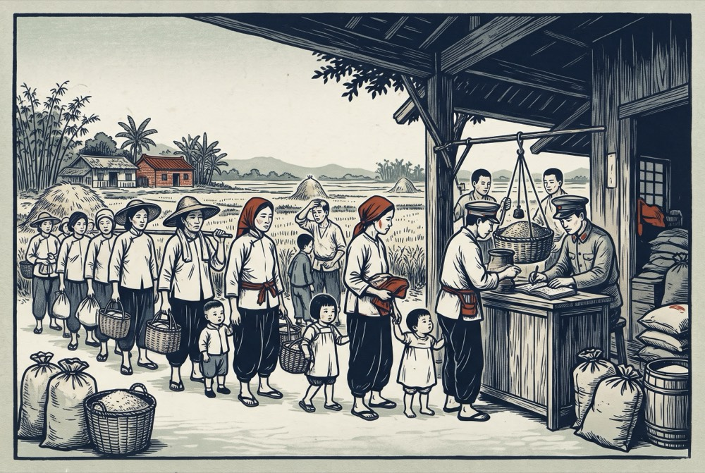
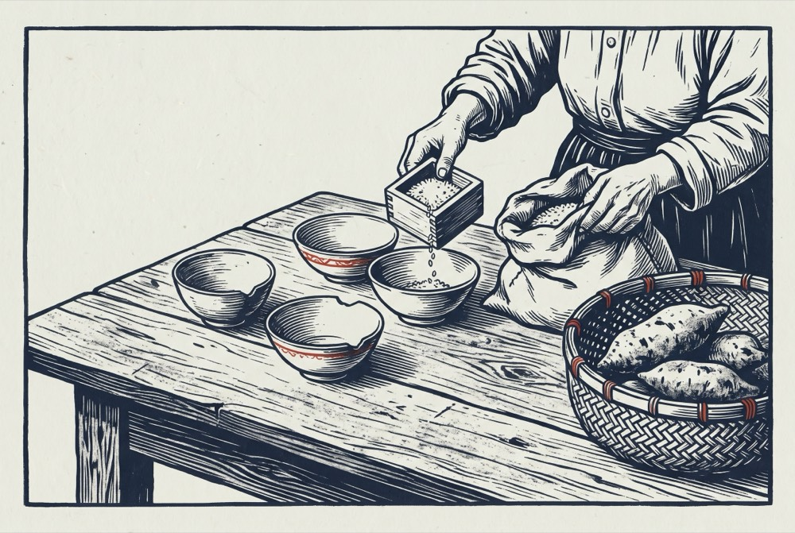

## 一句話說明

從 1940 年開始，米不能自由買賣了：農民收成要先交給政府，再由政府按「每人每天幾公克」分配給大家。

## 故事是這樣的

1937 年中日戰爭爆發，隔年日本公布〈國家總動員法〉（[國家總動員法](../entities/e-mobilization-law.md)），整個帝國進入「什麼都要為戰爭服務」的狀態。1939 年朝鮮和西日本大旱，米不夠了，日本頒布〈米穀配給統制法〉，臺灣總督府跟著發布規則，**從 1940 年第一期稻作開始，米的流通與分配由政府管理**（[曾品滄 2017](../sources/s-2017-tseng-table-war.md) 頁 6、8）。這一步臺灣其實走得比日本本土還早：總督府在 1940 年 5 月就宣布一期作米由政府完全管理，日本本土要到同年 10 月才公布類似的規則（[黃仁姿 2017](../sources/s-2017-huang-wartime-food-management.md) 頁 46–47）。

那場大旱有多嚴重？朝鮮運到日本的米，從 1939 年的 569 萬石掉到 1940 年的 39.5 萬石。日本只好轉向臺灣：1940 年規劃由臺灣移出 500 萬石，比 1939 年的 393 萬石多約 106 萬石（[李力庸 2009](../sources/s-2009-li-grain-regulation.md) 頁 77–78）。

規則是這樣的：種稻的農家扣掉自己要吃的和留做種子的，其餘由政府用公定價格強制收購，這叫「供出」。不只米，番薯、麥、大豆、花生、麵類也都包括在內（[曾品滄 2017](../sources/s-2017-tseng-table-war.md) 頁 9）。

負責收米的機構也一路整併。碾米業者與倉庫業者組成的「米穀納入組合」，是統一向農家收米的單位，成立時間兩位研究者寫得不同：黃仁姿寫 1940 年組成（[黃仁姿、薛化元 2019](../sources/s-2019-huang-irrigation-farm-org.md) 頁 132）；李力庸寫 1939 年就頒布了這套體制，但米商抵制，拖到 1941 年 6 月才全面運作（[李力庸 2009](../sources/s-2009-li-grain-regulation.md) 頁 90）。1943 年 12 月 29 日公布〈臺灣食糧管理令〉，主要糧食全部由政府收購、委託各地農業會辦理；配給則交給另一個機構「食糧營團」（[黃仁姿、薛化元 2019](../sources/s-2019-huang-irrigation-farm-org.md) 頁 133；[李力庸 2009](../sources/s-2009-li-grain-regulation.md) 頁 97）。一般家庭拿著「家庭用米穀配給券」，大約一個月去買兩次配給米（[李力庸 2009](../sources/s-2009-li-grain-regulation.md) 頁 93）。

每個人能分到多少米，是照營養學家算出的每日所需熱量的八成來訂的。一開始用容積算：種稻的人每天糙米 3 合 8 勺，一般人 2 合 5 勺。1942 年改成用重量算，並且照工作輕重分級：重勞動者 520 公克、輕勞動者／青少年／孕婦 390 公克、一般成年人 330 公克（[曾品滄 2017](../sources/s-2017-tseng-table-war.md) 頁 10）。「合」和「公克」怎麼對應？2 合 3 勺的七分搗米大約是 330 公克，換算成臺灣用的糙米則是 2 合 5 勺（[黃仁姿 2017](../sources/s-2017-huang-wartime-food-management.md) 頁 41 註 17）。到了 1945 年第一期稻作，標準又往下砍：種稻的人減一成，一般消費者減一成五（[黃仁姿 2017](../sources/s-2017-huang-wartime-food-management.md) 頁 50–51）。這次修正的理由之一是「提高國民體位」（[體位向上](../entities/e-taii.md)），孩子與營養的故事另見 [孩子吃什麼：戰時的營養與學童](t-wartime-children.md)。

紙上的標準是一回事，實際拿到的又是另一回事。1940 年 3 月新竹市把一般人的配給從 2 合 5 勺減成 2 合 2 勺；4 月澎湖減到 2 合，連產米的屏東也只配 1 合 7 勺。霧峰的林獻堂在 1941 年的日記裡嘆氣：配給米減了兩成，「非以蕃薯代用不可」（[曾品滄 2017](../sources/s-2017-tseng-table-war.md) 頁 11–12）。小說與回憶錄裡也常寫到：一個月份的配給米往往只能撐二十多天，剩下的日子要靠黑市或摻番薯籤（[黃仁姿 2017](../sources/s-2017-huang-wartime-food-management.md) 頁 65）；米店平時像歇業一樣，只有領米的日子，大家才拿著配給證上門（[黃仁姿 2017](../sources/s-2017-huang-wartime-food-management.md) 頁 50）。

政府還規定每個月逢 5、10、15……的日子是「節米日」：家裡三餐要有一餐吃粥或代用食，餐館、喫茶店當天不准賣白飯（[曾品滄 2017](../sources/s-2017-tseng-table-war.md) 頁 10）。

報紙也記下了節米運動從中央推到地方的過程。1939 年 10 月，《臺灣日日新報》登出日本農商大臣宣布「節米政策斷行」，同月節米的勅令案也送交總動員審議會（[臺灣日日新報 1939](../sources/s-1939-tnn-setsumai.md)，1939-10-07、1939-10-31）。1940 年 3 月，總督府決定限制米作為工業原料，稻穀與糙米也禁止作飼料（同上，1940-03-02）。同一個月，地方陸續行動：臺北州通牒「一週一回米飯拔き」（一週一次不吃白飯），高雄州定 1 日與 15 日為節米日，苗栗郡把購米分成五個階段、改用切符制（同上，1940-03-01、1940-03-09、1940-03-26）。

到了 1944 年，臺灣農民收成的米有 85.3% 要交給政府，比朝鮮（63.5%）和日本本土（60.5%）都高；可是番薯的供出率只有 6.28%，大部分留在農家自己吃（[李力庸 2009](../sources/s-2009-li-grain-regulation.md) 頁 94）。（推論）這也說明為什麼戰時臺灣人的飯碗裡，番薯越來越多。

收成本身也在下滑：1938 年全島產米約 982 萬石，1944 年剩 747 萬石，1945 年只剩 447 萬石，不到高峰的一半（[李力庸 2009](../sources/s-2009-li-grain-regulation.md) 頁 77）。

因為種稻的人配得多，有些地主乾脆收回佃農的田自己耕作，好讓自家被認定為「生產者」，多領一點米（[曾品滄 2017](../sources/s-2017-tseng-table-war.md) 頁 10–11）。

（推論）配給規則不只決定大家吃多少，也反過來改變了農村的土地安排。

## 數字會說話

**臺灣每年收成多少米？**（單位：萬石（糙米））

| 項目 | 稻米總產量 |
|---|---|
| 1936 | 955.8 |
| 1937 | 923.3 |
| 1938 | 981.7 |
| 1939 | 915.2 |
| 1940 | 790.1 |
| 1941 | 839.3 |
| 1942 | 819.8 |
| 1943 | 788.1 |
| 1944 | 747.2 |
| 1945 | 447.2 |

李力庸表二（頁 77），資料來自總督府《臺灣米穀要覽》；原單位石，本站換算成萬石。蘇瑤崇（頁 98）1938–1943 年數字完全相同，1944、1945 年略異（747.7、438.3 萬石）。1 石約 140 公斤。 出處：[李力庸 2009](../sources/s-2009-li-grain-regulation.md)

**1944 年，收成有多少要交給政府？**（單位：%（米的供出率））

| 項目 | 供出率 |
|---|---|
| 臺灣 | 85.3 |
| 朝鮮 | 63.47 |
| 日本本土 | 60.46 |

李力庸（頁 94）。供出率是政府收購量占實際收成的比例。同年臺灣甘藷的供出率只有 6.28%，番薯大多留給自己吃。 出處：[李力庸 2009](../sources/s-2009-li-grain-regulation.md)

**1942 年起，每人每天能配到多少米？**（單位：公克／天（七分搗米））

| 項目 | 配給標準 |
|---|---|
| 種稻的農家 | 520 |
| 重勞動者 | 520 |
| 輕勞動者、青少年、孕婦 | 390 |
| 一般成年人 | 330 |

這是政府訂的「標準量」，實際領到的常常更少。 出處：[曾品滄 2017](../sources/s-2017-tseng-table-war.md)

**1940 年春天，各地實際配給的米**（單位：合／人／天（糙米））

| 項目 | 一般人每日配給 |
|---|---|
| 全國標準（一般人） | 2.5 |
| 新竹市 | 2.2 |
| 澎湖 | 2.0 |
| 屏東市 | 1.7 |

1 合約 180 毫升（一般換算，非出自本資料）。地方政府以「節米」為由減配，產米的屏東反而最少。 出處：[曾品滄 2017](../sources/s-2017-tseng-table-war.md)

## 研究者怎麼看

- 曾品滄指出，米的消費標準「全國一體」，條文上沒有日臺差別；但地方官員可以決定誰算「勞動者」，結果不少在機關、學校上班的在臺日人被認定為勞動者，多領了米（[曾品滄 2017](../sources/s-2017-tseng-table-war.md) 頁 9–10、12）。
- 李力庸比較臺灣與朝鮮：臺灣是「生產收購」（臺灣農業會）和「配給」（食糧營團）分開的雙元制，朝鮮由單一團體包辦；她認為臺灣的生產較穩定，收購和配給也較有秩序（[李力庸 2009](../sources/s-2009-li-grain-regulation.md)）。
- 為什麼 1939 年突然要管米？李力庸指出，原本是日本主要米倉的朝鮮在 1939 年大旱減產，打亂了整個帝國的糧食布局；朝鮮自己也付出慘痛代價，1939 到 1942 年路邊餓死的人超過一萬八千人（[李力庸 2009](../sources/s-2009-li-grain-regulation.md) 頁 77、95）。更早的背景是：1920 年後日本糧食政策轉向帝國內自給，臺灣經歷在來米、蓬萊米兩階段改良，成為重要米倉（[李力庸 2022](../sources/s-2022-li-rice-production-tw-kr.md)）。
- **帳面上夠吃，生活裡不夠吃？** 黃仁姿依《臺灣食糧年鑑》推算，到 1944 年為止臺灣的米扣掉島內消費和運出島外的量都還有剩，1945 年才短缺近 160 萬石；但這跟小說、回憶裡「配給米只撐二十多天」的經驗有落差。她推測，1943 年後船運困難，被收走的米可能流向在臺的大批軍隊——終戰前光陸軍就有約 30 萬人（[黃仁姿 2017](../sources/s-2017-huang-wartime-food-management.md) 頁 63–65）。
- **米產量有兩套數字**：李力庸引《臺灣米穀要覽》，1942–1944 年是 819.8、788.1、747.2 萬石（[李力庸 2009](../sources/s-2009-li-grain-regulation.md) 頁 77）；黃仁姿引林肇《臺灣食糧年鑑》，同樣三年是 804.8、818.4、794.4 萬石（[黃仁姿 2017](../sources/s-2017-huang-wartime-food-management.md) 頁 65）。兩份統計出處不同，研究者都沒有說明差在哪裡。
- 黃仁姿追問：戰時的糧食汲取（供出）制度，怎麼延續到戰後國民政府的農政？這把戰時與戰後的米連成同一個故事（[黃仁姿 2016](../sources/s-2016-huang-wartime-agri-policy.md)，接續看 [戰爭結束了，米卻更少了：戰後米荒](t-postwar-famine.md)）。

## 延伸閱讀

- [曾品滄 2017](../sources/s-2017-tseng-table-war.md)
- [李力庸 2009](../sources/s-2009-li-grain-regulation.md)
- [黃仁姿 2017](../sources/s-2017-huang-wartime-food-management.md)
- [黃仁姿、薛化元 2019](../sources/s-2019-huang-irrigation-farm-org.md)
- [臺灣日日新報 1939](../sources/s-1939-tnn-setsumai.md)（報紙標題清單，只有標題）
- [李力庸 2022](../sources/s-2022-li-rice-production-tw-kr.md)（本站只讀到摘要）
- [黃仁姿 2016](../sources/s-2016-huang-wartime-agri-policy.md)（本站只讀到摘要）

## 還不知道的事

- 1943–1945 年實際配給量（不是標準量）逐年變化的完整數字。李力庸的研究只說明配給的組織與頻率，沒有每人配給量。
- 1945 年調降後的實際公克數：只知道「依 1942 年標準，一般消費者減一成五」（[黃仁姿 2017](../sources/s-2017-huang-wartime-food-management.md) 頁 50），沒有看到公告的數字。
- 「合」換算成公克：目前只有「2 合 3 勺七分搗米約 330 公克」一個對照（[黃仁姿 2017](../sources/s-2017-huang-wartime-food-management.md) 頁 41 註 17），糙米、白米各自的換算還沒找到。
- 曾品滄寫節米日是逢 5、10、15 日；報紙標題（[臺灣日日新報 1939](../sources/s-1939-tnn-setsumai.md)）只看到高雄州是 1 日與 15 日。兩者是否為全島統一的規定，尚未查證。
- 《臺灣省五十一年來統計提要》（[臺灣省行政長官公署統計室 1946](../sources/s-1946-tw-provincial-stat-51yrs.md)）列有米穀生產表，可以和李力庸、蘇瑤崇的數字互相核對，但本站還沒取得表格內容。
