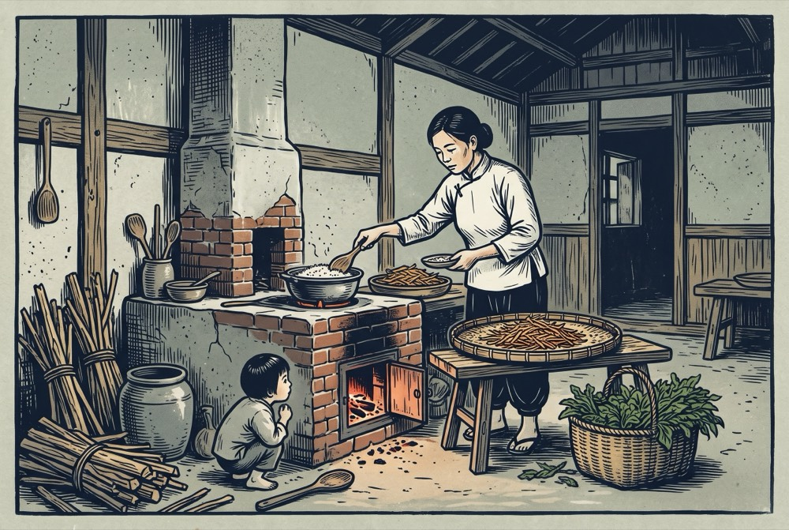
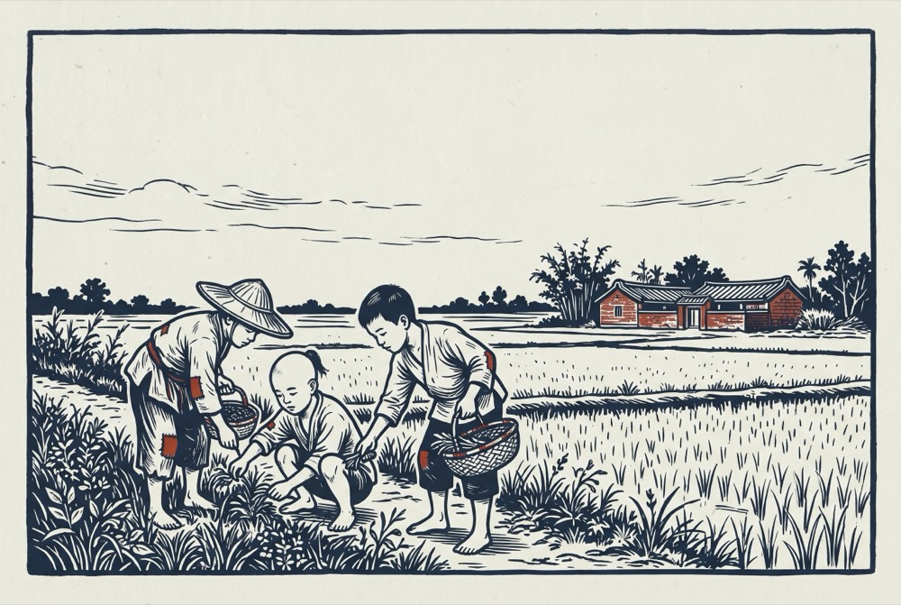

## 一句話說明

米不夠吃的時候，政府和老百姓各有辦法：政府推「科學的」代用食，老百姓則把阿嬤年代的救荒食物重新端上桌。

## 故事是這樣的

政府大力宣傳代用食：用番薯籤、樹薯粉代替米，用蝸牛、兔肉補蛋白質，甚至用烘過的番仔豆當咖啡。還推「共同炊煮」省燃料，要求大家把飯「完全咀嚼」好吸收營養（[曾品滄 2017](../sources/s-2017-tseng-table-war.md) 頁 20）。宣傳還要家庭休假時至少吃一餐番薯，總督長谷川清也吃番薯便當作示範；蔡承豪認為這主要是說給日本人和有錢人聽的，因為臺灣人煮飯本來就常加番薯籤（[蔡承豪 2024](../sources/s-2024-tsai-wartime-food-control.md) 頁 20）。

報紙上的代用食，也從示範走到制度。1941 年 10 月，《臺灣日日新報》南方共榮版連載「代用食二つ」，示範用剩飯與番薯做代用食（[臺灣日日新報 1941](../sources/s-1941-tnn-daiyoshoku.md)，1941-10-04）。同年 11 月，「消費米代用食全面的管理」斷行（同上，1941-11-13）；基隆市則依人數配給乾烏龍麵（同上，1941-11-21）。1942 年 5 月，報紙宣傳新興代用食「海寶米」，目標是節省米麥一百萬石，麻豆街將設大型工廠（同上，1942-05-06）。1943 年起，報導重點轉向作物與新產品：屏東推木瓜、新竹州推燕麥栽培，甜稞（甘餅）近日上市，還有用屑米與澱粉做的「蓬萊うどん」（同上，1943-02-10、1943-08-04、1943-11-05、1943-12-31）。

一般人更常靠自己。住在城裡的人在空地養雞鴨、種花生和番薯；親戚朋友互相接濟。作家吳濁流缺糧時，學生家長扛了一斗米來看他，他形容「就好像在地獄裡遇到佛祖」（[曾品滄 2017](../sources/s-2017-tseng-table-war.md) 頁 20）。

官方也推「鄉土食」，但選錯了方向。1941 年臺灣食糧研究會找臺北帝大和女學校老師一起選定的鄉土食，是午餐麵包、燒蕎麥麵、甘薯龜、高砂麵包這類，不是麵包就是麵條，跟臺灣人吃粥吃飯的習慣差很多，沒有引起什麼回應（[曾品滄 2013](../sources/s-2013-tseng-hometown.md) 頁 131）。日本本土 1941 年做的全國鄉土食習調查，也沒有在臺灣實施（同上）。

被遺忘的鄉土食也回來了：醬瓜、豆豉配飯，田裡的青蛙、魚蝦、豬雞內臟，還有黑甜仔（龍葵）、野莧這些野菜。原本拿來餵豬的茄茉菜，這時大家搶著吃；空心菜好種，市場上滿坑滿谷（[曾品滄 2017](../sources/s-2017-tseng-table-war.md) 頁 20–21）。連霧峰林家這樣的富人家，主食也改成番薯或番薯籤（[曾品滄 2013](../sources/s-2013-tseng-hometown.md) 頁 132）。國民學校老師陳氏菫霞在 1944 年寫道，從前沒人要的蔭豉、菜脯、醃瓜，如今成了不可或缺的下飯菜，「即使對這些寒酸的菜餚，也得深懷謝意」（同上，頁 134）。

數字也看得出番薯的地位。1944 年，臺灣農民收成的米有 85% 要交給政府，番薯卻只要交 6.28%，大部分留在家裡吃（[李力庸 2009](../sources/s-2009-li-grain-regulation.md) 頁 94）。但整體來說，番薯也不夠：每人每天能分到的番薯，從戰前（1935–39 平均）的 309 公克，降到 1940–44 年的 250 公克、1945 年的 184 公克（[曾品滄 2018](../sources/s-2018-tseng-public-diet.md) 頁 125）。

到了 1945 年，連新竹的黃旺成家都在日記裡寫：「米欠三日，晝用樹薯粉，各僅半飽」（[曾品滄 2017](../sources/s-2017-tseng-table-war.md) 頁 19–20）。

## 數字會說話

**一個臺灣人一天能吃到多少？**（單位：公克／人／天）

| 項目 | 1935–39 平均 | 1940–44 平均 | 1945 |
|---|---|---|---|
| 米 | 251 | 298 | 237 |
| 番薯 | 309 | 250 | 184 |
| 蔬菜 | 170 | 122 | 103 |
| 肉 | 51 | 30 | 16 |
| 魚 | 56 | 27 | 6 |

Gleason（1956）估算的每人每日可供量，轉引自曾品滄（2018）表 1（頁 125），本站已對照原頁影像。這是全島平均的「可供量」，不是實際吃進去的量。1945 年食物總量 620 公克，是戰前 994 公克的 62%。 出處：[曾品滄 2018](../sources/s-2018-tseng-public-diet.md)

## 研究者怎麼看

- 曾品滄認為，飲食貼近本地風土的臺灣人，比堅持吃內地食物的日本人更能撐過缺糧；人們也透過這些鄉土食「重新認識臺灣傳統生活文化的價值」（[曾品滄 2017](../sources/s-2017-tseng-table-war.md) 頁 21）。
- 曾品滄 2013 指出，官方推的是用鄉村材料做的「代用食」，臺灣人自己靠的則是原本就有的救荒技術和家常菜；戰爭讓城裡的中上階層重新認識這些被看不起的「庄腳菜」（[曾品滄 2013](../sources/s-2013-tseng-hometown.md) 頁 131–134）。
- 當時不少在臺日本學者也主張向臺灣飲食學習，例如熱帶醫學研究所的冨士貞吉、營養學家安間節子；臺灣植物同好會在 1945 年出版了《臺灣野生食用植物圖譜》（[曾品滄 2017](../sources/s-2017-tseng-table-war.md) 頁 34–35）。

## 延伸閱讀

- [曾品滄 2017](../sources/s-2017-tseng-table-war.md)
- [李力庸 2009](../sources/s-2009-li-grain-regulation.md)
- [曾品滄 2018](../sources/s-2018-tseng-public-diet.md)
- [曾品滄 2013](../sources/s-2013-tseng-hometown.md)（戰時鄉土食怎麼改寫「臺灣料理」，還有山水亭的故事）
- [臺灣日日新報 1941](../sources/s-1941-tnn-daiyoshoku.md)（報紙標題清單，只有標題）
- [孩子吃什麼：戰時的營養與學童](t-wartime-children.md)（孩子的營養與學校裡的便當）
- [蔡承豪 2024](../sources/s-2024-tsai-wartime-food-control.md)（科普短文，刊名未印出）

## 還不知道的事

- 戰後（1945–1949）番薯在主食中的比例變化。
- 政府代用食宣傳的實際內容（食譜、海報）。
- 「海寶米」的實際產量與供應情況。報紙標題（[臺灣日日新報 1941](../sources/s-1941-tnn-daiyoshoku.md)）之後沒有後續報導，尚未查到。
