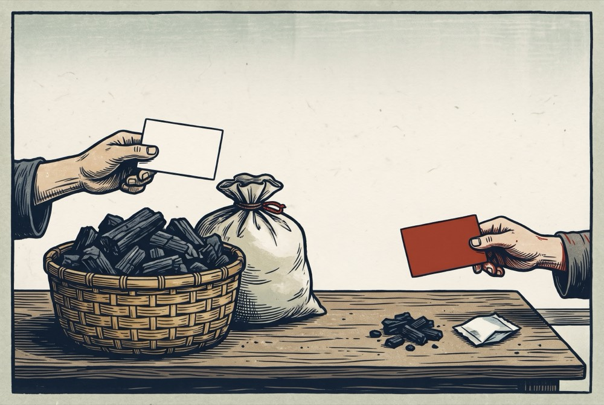
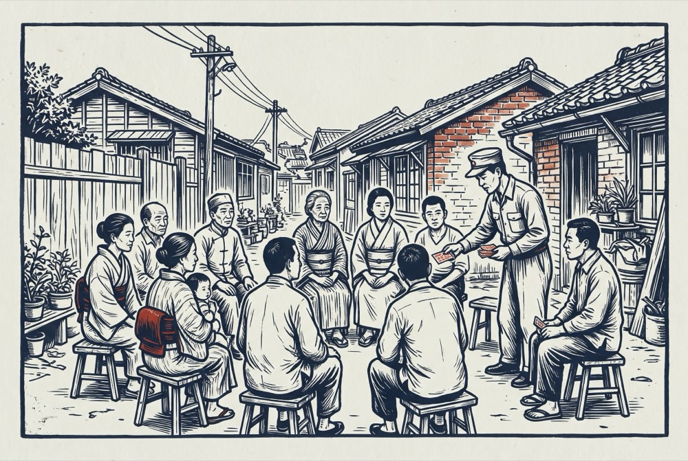

## 一句話說明

政府一邊喊「內臺一體」（日本人和臺灣人是一家人），一邊在配給時把人分成日本人、國語家庭、一般臺灣人，分到的東西不一樣多、也不一樣好。

## 故事是這樣的

戰爭需要臺灣人出力，所以政府到處宣傳「內臺一體」「臺灣一家」，連皇民奉公會（[皇民奉公會](../entities/e-hokokai.md)）最基層的奉公班（[奉公班](../entities/e-hokohan.md)）開會都要講（[曾品滄 2017](../sources/s-2017-tseng-table-war.md) 頁 7）。

但看看臺北市 1941 年的豬肉配給：以「戶」為單位，每戶每 10 天配 300 公克。聽起來很公平？可是當年臺北日本人家庭平均 4.01 人，臺灣人家庭平均 5.21 人。換算下來，臺灣人每人分到的豬肉不到日本人的八成（[曾品滄 2017](../sources/s-2017-tseng-table-war.md) 頁 13–14）。

有的地方更直接。高雄苓雅寮的區會把配給分成甲乙兩類：日本人拿精肉，臺灣人拿油脂、內臟、耳朵、鼻子和豬腳（[曾品滄 2017](../sources/s-2017-tseng-table-war.md) 頁 14）。

1940 年底臺北市的砂糖和木炭也一樣分等：日本人和較富裕的臺灣人每人每月砂糖 0.6 公斤，其他臺灣人 0.3 公斤；木炭白卡（日本人、國語家庭 [國語家庭](../entities/e-kokugo-family.md)、改日本姓名者）20 公斤，紅卡（一般臺灣人）只有 5 公斤（[曾品滄 2017](../sources/s-2017-tseng-table-war.md) 頁 15）。

臺灣人都看在眼裡。公學校老師張建墻回憶，配給分成三等：日本人全額、改日本名的臺灣人特別加額、大多數臺灣人挨餓。律師陳逸松則拒絕為了多領配給去申請國語家庭，他說戰時大家都苦，「應該有難同當」（[曾品滄 2017](../sources/s-2017-tseng-table-war.md) 頁 16）。

## 數字會說話

**一般臺灣人拿到的，是日本人的幾 %？**（單位：%（日本人 = 100））

| 項目 | 一般臺灣人 |
|---|---|
| 砂糖（1940） | 50 |
| 木炭（1940） | 25 |
| 毛巾（1941，每戶） | 33 |
| 手巾（1941，每戶） | 50 |
| 豬肉（1941，每人） | 77 |

依論文中臺北市的配給規定換算：砂糖 0.3÷0.6；木炭紅卡 5÷白卡 20 公斤；毛巾日本人 1 戶 2 條、臺灣人 3 戶 2 條；手巾 1 戶 1 條對 2 戶 1 條；豬肉每戶相同，但臺灣人家庭平均 5.21 人、日本人 4.01 人，4.01÷5.21≈77%。 出處：[曾品滄 2017](../sources/s-2017-tseng-table-war.md)

**臺北人每 10 天吃到多少豬肉？**（單位：公克／人／10 天）

| 項目 | 每人豬肉 |
|---|---|
| 1930 年代平時 | 350 |
| 1941 配給：日本人家庭 | 74.8 |
| 1941 配給：臺灣人家庭 | 57.6 |

1930 年代為每人每天約 35 公克 × 10。1941 年每戶每 10 天 300 公克，除以家庭平均人數（日本人 4.01、臺灣人 5.21）。換算為本站計算。 出處：[曾品滄 2017](../sources/s-2017-tseng-table-war.md)

## 研究者怎麼看

- 曾品滄認為，差別配給其實是**皇民化運動的輔助工具**：用多幾兩肉、可以買白糖，鼓勵臺灣人改姓名、講國語（[曾品滄 2017](../sources/s-2017-tseng-table-war.md) 頁 16、32）。
- 但他也提醒，配給品項太多、各地辦法不同，差別待遇的程度「幾乎無從判定」；臺灣人自己的說法也不一致——有人說分三等，有人說只要是國語家庭就跟日本人一樣（[曾品滄 2017](../sources/s-2017-tseng-table-war.md) 頁 15–16）。
- 到 1943–44 年物資枯竭，就算日本人多分一點也吃不飽，差別配給「除了徒增民族間的隔閡」，實際作用有限（[曾品滄 2017](../sources/s-2017-tseng-table-war.md) 頁 17）。

## 延伸閱讀

- [曾品滄 2017](../sources/s-2017-tseng-table-war.md)

## 還不知道的事

- 臺北以外的城市（臺中、臺南）有沒有類似的分卡制度？
- 原住民族（當時稱「高砂族」）在配給制度中的實際處境。
